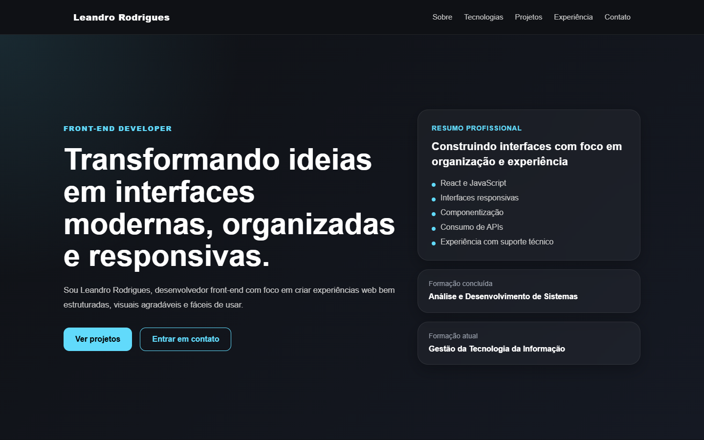

# Portfólio — Leandro Rodrigues

Meu portfólio de desenvolvedor front-end: apresentação, tecnologias, projetos com links de demo e código, experiência profissional e contato.


**Site:** [meu-portfolio-leandro-rodrigues.vercel.app](https://meu-portfolio-leandro-rodrigues.vercel.app)



## Destaques técnicos

- **Componentes por responsabilidade:** `layout/` (Header, Footer), `sections/` (Hero, About, Tech, Projects, Experience, Contact) e `ui/` (Button, ProjectCard, TechBadge, SectionTitle).
- **Conteúdo separado da interface:** projetos, tecnologias e experiências ficam em `src/data/`. Para adicionar um projeto, basta incluir um objeto em `projects.js`.
- Animações de rolagem com AOS.
- Estilização em CSS puro, com layout responsivo.

## Estrutura

```
src/
├── components/
│   ├── layout/
│   ├── sections/
│   └── ui/
├── data/        # projects.js, techs.js, experiences.js
└── styles/
```

## Como executar

```bash
git clone https://github.com/EldenXLe/Meu-Portfolio-Leandro-Rodrigues.git
cd Meu-Portfolio-Leandro-Rodrigues
npm install
npm run dev
```

## Contato

[LinkedIn](https://www.linkedin.com/in/leandrorodrigues-dev/) · [GitHub](https://github.com/EldenXLe)
